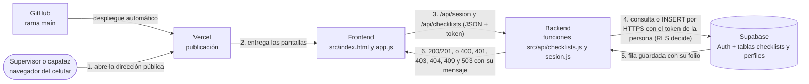

# Arquitectura y PoC · ReporteMtto

La prueba de concepto (PoC) recorre de punta a punta **una sola acción**: el supervisor entrega el checklist de una actividad. El dato viaja desde el teléfono hasta una base de datos real, el servidor lo valida y la persona recibe un folio. Todo lo demás del prototipo sigue simulado.

## Diagrama de componentes

| Pieza | Qué hace en nuestra solución | Con qué está hecha | Con quién se comunica |
|---|---|---|---|
| Frontend | Muestra las cinco pantallas del checklist, valida los campos antes de enviar y, al tocar «Guardar y enviar», manda los datos al backend. Muestra el folio si se guardó, el error si el servidor lo rechazó, o «Pendiente de envío» si no hay conexión. Guarda los pendientes en el navegador del teléfono y los reenvía al volver la señal. | HTML, CSS y JavaScript sin librerías (`src/`) | Backend, por `POST /api/checklists` |
| Backend | Recibe el checklist, lo valida de nuevo (el servidor es el que manda: ignora los campos que no están en su lista, rechaza datos inválidos y calcula él mismo la duración y las horas hombre), lo guarda y responde con el folio o con el error. | Funciones de Node.js (`src/api/checklists.js`, `sesion.js`, `_validar.js`, `_usuario.js`, `_supa.js`), sin librerías | Frontend y Supabase |
| Base de datos | Guarda cada checklist entregado como una fila de la tabla `checklists`, con las mismas reglas como segunda defensa (el N° de OT con 9 dígitos, turno día o noche, minutos sin valores negativos). Desde el Avance 8, cada usuario entra con su sesión y las políticas RLS deciden qué filas ve y cambia (ver `docs/permisos.md`). | Supabase (PostgreSQL), esquema en `supabase/schema.sql` | Backend, por su API REST |
| Publicación | Pone el sitio y la función en una dirección pública, sin iniciar sesión, y guarda las claves como variables de entorno. | Vercel, con la carpeta raíz `src` | GitHub (recibe el código) y las personas (abren la dirección) |
| Repositorio | Guarda el código y la documentación; la rama `main` es lo que se publica y lo que se entrega. No contiene claves. | GitHub | Vercel |

**Servicio externo:** ninguno para el negocio (no hay integración con SAP). Supabase y Vercel son piezas que usamos pero no controlamos, y para eso existe el plan de falla.

**Plan de falla.** Si Supabase no responde, o el servidor no se alcanza:
- **Qué ve la persona:** «Checklist guardado · Pendiente de envío», con el aviso «No pudimos conectar con el servidor. Se reintentará cuando haya conexión». No ve un error técnico.
- **Qué hace mientras tanto:** avisa por radio al ingeniero de turno o al planificador, como lo hace hoy, y puede abrir un checklist nuevo. Cuando vuelve la conexión, el prototipo reenvía solo los pendientes.
- **Dónde queda el checklist:** guardado en el navegador del teléfono (`localStorage`), así que no se pierde si se cierra la aplicación. Al abrirla de nuevo aparece «Tienes 1 checklist sin enviar»; con señal se envía solo, o con el botón «Enviar ahora».
- **Límite de la PoC:** si se borran los datos del navegador, el pendiente se pierde. Una cola de envío completa (IndexedDB, reintentos programados y aviso al programador si nunca llega) queda fuera de esta prueba.

## Camino delgado

**Acción:** el supervisor entrega el checklist de una actividad («Guardar y enviar», historia HU-01). Una entrada en pantalla, una validación en el servidor, un registro guardado y un folio como respuesta.

**Por qué es lo más frágil:** todo el valor de la solución depende de que un dato completo y válido llegue del teléfono al registro que después verá el programador. Hoy ese dato llega tarde (uno o dos días) y con menos detalle. Si esta acción no funciona con piezas reales, la bandeja, el documento y el resto no tienen sobre qué apoyarse. Además depende de la señal de la planta, tanto en superficie como en interior mina. Si el envío falla, la documentación se entrega igual al día siguiente, que es justo el problema que queremos resolver.

**Queda fuera por ahora** (es una decisión, no un olvido):
- **La sincronización completa sin señal.** Se prueba lo básico (el pendiente se guarda en el teléfono y se reenvía al volver la señal), pero no la cola completa con IndexedDB, los reintentos programados ni abrir la aplicación sin conexión desde cero.
- **La firma:** se dibuja en pantalla, pero no se envía ni se guarda.
- **Inicio de sesión y usuarios:** el nombre, el cargo y la empresa vienen de un perfil de ejemplo.
- **La bandeja del programador, la edición del N° de OT y el documento descargable:** siguen simulados con datos de ejemplo.

**Si algo falla, la persona ve:**
- **Un dato inválido que el formulario dejó pasar:** el servidor no guarda nada y responde con un mensaje que dice cómo corregirlo (por ejemplo, «El N° de OT tiene 9 dígitos…»). El botón queda disponible para reintentar.
- **El servidor o la base no responden:** «Pendiente de envío», como en el plan de falla.
- **Sin señal:** el teléfono ni intenta enviar, guarda el checklist y lo muestra como pendiente hasta que vuelva la señal.

## Decisiones de arquitectura (ADR)

**ADR 1 · El servidor decide, el formulario solo acompaña**
- **Contexto:** el formulario ya valida en el teléfono, pero cualquiera puede alterar una petición y guardar datos inválidos.
- **Decisión:** el servidor (`src/api/checklists.js`) vuelve a validar todo, calcula la duración y las horas hombre, y la base de datos agrega sus propias restricciones.
- **Alternativa descartada:** confiar solo en la validación del formulario.
- **Consecuencias:** la regla existe en tres lugares (formulario, servidor y base) y hay que mantenerlas iguales; a cambio, un dato inválido nunca queda guardado.

**ADR 2 · Supabase (PostgreSQL) como base de datos**
- **Contexto:** se necesita guardar el checklist de verdad, con un servicio gratuito que el equipo pueda configurar sin administrar un servidor.
- **Decisión:** Supabase, al que el servidor le habla por su API web. En el Avance 7 lo hacía con la clave secreta; desde el Avance 8 usa el token de cada persona (ver ADR 4).
- **Alternativa descartada:** guardar en un archivo o en la memoria del servidor, que se pierde en cada despliegue.
- **Consecuencias:** depende de un servicio externo; por eso existe el plan de falla («Pendiente de envío»). La clave nunca va en el repositorio.

**ADR 3 · Funciones de Vercel en la misma carpeta, sin servidor propio**
- **Contexto:** la aplicación ya estaba publicada en Vercel como página estática.
- **Decisión:** el backend son funciones de `src/api/`, que Vercel publica junto con la página, sin servicio extra que pagar ni mantener.
- **Alternativa descartada:** un servidor aparte (por ejemplo, en otro servicio de alojamiento).
- **Consecuencias:** un solo lugar de publicación y una sola dirección web; el límite es que cada función es corta y sin estado.

**ADR 4 · El servidor entra a la base con el token de cada persona, no con la clave secreta (Avance 8)**
- **Contexto:** con la clave secreta, el servidor se saltaba todas las reglas de la base. Si una revisión de permisos en el código fallaba, nada más lo frenaba.
- **Decisión:** la persona inicia sesión con Supabase Auth. El servidor confirma su token y su rol en cada petición, y entra a la base con ese mismo token y la clave pública. Así las políticas RLS revisan cada fila. La duración, las horas hombre, el autor y quién recibió o anuló los pone la base.
- **Alternativa descartada:** seguir con la clave secreta y revisar los permisos solo en el servidor.
- **Consecuencias:** hay tres revisiones independientes (pantalla, servidor y base), y la clave secreta sale de la aplicación. A cambio, el SQL de políticas es más largo y cada petición hace una consulta extra para leer el rol.

## Evidencia

Dirección pública: https://checklist-mantenimiento-src.vercel.app · Video: [caso exitoso y caso de error](https://drive.google.com/file/d/1fCneYLfVQAqYovRSSEhnulLa-g8c7d4w/view?usp=sharing) · Caso de error probado: con el control «Envío: Con N° de OT inválido (PoC)» el servidor rechaza el checklist, muestra el mensaje y no guarda ninguna fila.

**Prueba con la base real (20-11-2026):** caso exitoso con folio ([pantalla](img/poc/01-exitoso-folio1.png), [fila en Supabase](img/poc/02-supabase-fila1.png)), error del servidor sin guardar nada ([mensaje](img/poc/04-servidor-rechaza-ot.png), [tabla sin cambios](img/poc/05-supabase-sigue-1-fila.png)) y pendiente sin señal que se envía al reabrir ([pendiente](img/poc/08-sin-senal-pendiente.png), [fila 3](img/poc/09-supabase-3-filas-reenvio.png)). Lista completa en [prueba-humo.md](prueba-humo.md).
