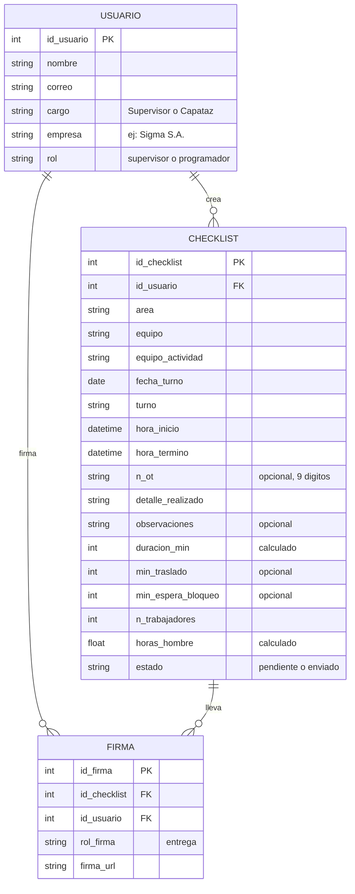

# Estructura de datos preliminar

La estructura sigue los recuadros del «Check list entrega trabajos de mantenimiento», el formato que ya autorizó el mandante. Un checklist registra una actividad.

## 1. Diagrama

Fórmula de horas hombre: (duración en minutos + min_traslado + min_espera_bloqueo) x n_trabajadores / 60. La duración sale de la hora de inicio y la hora de término.

Cómo se corresponde con la hoja oficial:

| Recuadro de la hoja | Campo |
|---|---|
| Área | `CHECKLIST.area` |
| Equipo (encabezado) | `CHECKLIST.equipo` |
| Fecha turno | `CHECKLIST.fecha_turno` y `CHECKLIST.turno` |
| Nombre quien entrega, Cargo, Empresa | `USUARIO.nombre`, `USUARIO.cargo`, `USUARIO.empresa` (vienen del perfil, no se escriben en cada checklist) |
| Firma de quien entrega | `FIRMA.firma_url` con `rol_firma` = entrega |
| Equipo (fila de la actividad) | `CHECKLIST.equipo_actividad`: puede ser un sub equipo distinto del equipo del encabezado |
| Detalle realizado | `CHECKLIST.detalle_realizado` |
| Hora inicio y hora término | `CHECKLIST.hora_inicio` y `CHECKLIST.hora_termino` |
| N° OT SAP | `CHECKLIST.n_ot` |
| Observaciones detectadas durante recepción de actividades | `CHECKLIST.observaciones` |
| Duración actividad, tiempo traslado, tiempo espera bloqueo, N° trabajadores | `duracion_min`, `min_traslado`, `min_espera_bloqueo`, `n_trabajadores` |
| Nombre, cargo, empresa y firma de quien recibe | No se registra en la app: lo completa el mandante en el documento impreso |

La firma de quien recibe no se registra en la app: la hace en el documento impreso que le lleva el programador.

El N° SAP de un repuesto no es un campo: de momento se anota dentro de `observaciones`.

La tabla FOTO queda fuera del prototipo del Avance 5: la hoja oficial no tiene recuadro para fotografías y ninguna historia de usuario las pide. Se retoma solo si se agrega una historia que la justifique.

### Listas de opciones

- **Área:** Superficie, Chancado, Transporte intermedio, Transporte principal u Otro (se escribe a mano).
- **Equipo:** según el área, o Otro (se escribe a mano).
  - Chancado y Transporte intermedio: Chancador, Apron Primario, Correa de Finos, Apron Secundario, Correa Sacrificio y Correa Intermedia, cada uno en las líneas L1, L2 y L3; más Correa Colectora Norte y Correa Reversible. Todavía no se define qué equipo va en cada una de las dos áreas, así que ambas muestran la misma lista.
  - Transporte principal: Alimentador Norte, Alimentador Sur, Correa Nivel 1, Correa Transferencia, Correa Principal 1, Correa Principal 2, Correa Overland, Alimentador 1, Alimentador 2, Correa Pila Mina, Correa Complementaria y Correa 442.
  - Superficie: sin lista por ahora, se escribe a mano.
- **Turno:** día o noche; se preselecciona según la hora, pero la persona puede cambiarlo.
- **Cargo:** Supervisor o Capataz.

### Relaciones y cardinalidad

| Relación | Cardinalidad | Se lee | Clave externa |
|---|---|---|---|
| USUARIO → CHECKLIST | 1 : N | Un usuario (supervisor o capataz) crea muchos checklist; cada checklist tiene un solo autor | `CHECKLIST.id_usuario` |
| USUARIO → FIRMA | 1 : N | Un usuario firma muchos checklist; cada firma es de un solo usuario | `FIRMA.id_usuario` |
| CHECKLIST → FIRMA | 1 : N | Un checklist lleva la firma de quien entrega; cada firma pertenece a un solo checklist | `FIRMA.id_checklist` |

## 2. Campos obligatorios y ejemplos

Campos obligatorios (los que no pueden quedar vacíos):
- USUARIO: id_usuario, nombre, correo, cargo, empresa, rol
- CHECKLIST: id_checklist, id_usuario, area, equipo, equipo_actividad, fecha_turno, turno, hora_inicio, hora_termino, detalle_realizado, duracion_min, n_trabajadores, horas_hombre, estado. Opcionales: n_ot, observaciones, min_traslado, min_espera_bloqueo (si no hubo, vale 0).
- FIRMA: id_firma, id_checklist, id_usuario, rol_firma, firma_url

### USUARIO
| id_usuario | nombre | correo | cargo | empresa | rol |
|---|---|---|---|---|---|
| 1 | Juan Pérez | jperez@ejemplo.cl | Supervisor | Sigma S.A. | supervisor |
| 2 | Marta Soto | msoto@ejemplo.cl | Programador de mantenimiento | Sigma S.A. | programador |

### CHECKLIST
| id_checklist | id_usuario | area | equipo | equipo_actividad | fecha_turno | turno | hora_inicio | hora_termino | n_ot | detalle_realizado | observaciones | duracion_min | min_traslado | min_espera_bloqueo | n_trabajadores | horas_hombre | estado |
|---|---|---|---|---|---|---|---|---|---|---|---|---|---|---|---|---|---|
| 101 | 1 | Transporte intermedio | Correa Intermedia L1 | Polea de cola de Correa Intermedia L1 | 2026-09-25 | noche | 2026-09-25 20:15 | 2026-09-25 22:40 | 111254880 | Se cambian 3 polines de carga en el tramo de descarga y se revisa la alineación de la correa. | | 145 | 70 | 35 | 3 | 12.5 | enviado |
| 102 | 1 | Transporte principal | Alimentador Norte | Buzón de carga de Alimentador Norte | 2026-09-26 | día | 2026-09-26 09:00 | 2026-09-26 11:30 | | Se reemplaza el faldón lateral del buzón de carga y se limpia el material acumulado. | | 150 | 30 | 0 | 2 | 6.0 | pendiente |

### FIRMA
| id_firma | id_checklist | id_usuario | rol_firma | firma_url |
|---|---|---|---|---|
| 1 | 101 | 1 | entrega | firmas/101_entrega.png |
| 2 | 102 | 1 | entrega | firmas/102_entrega.png |
