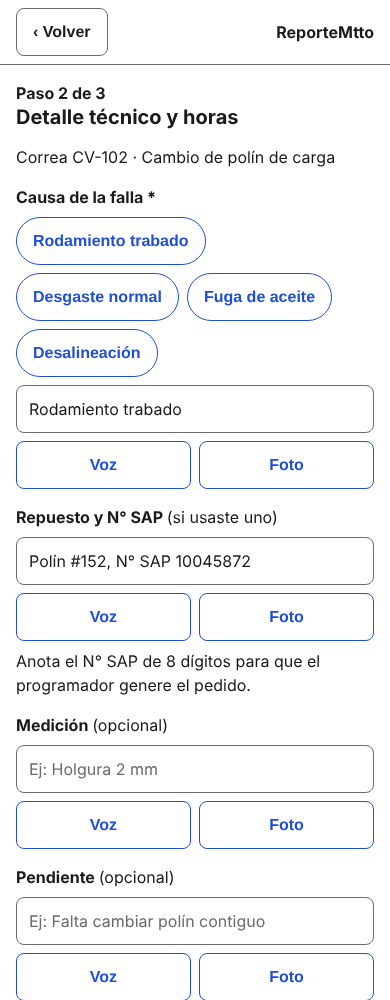
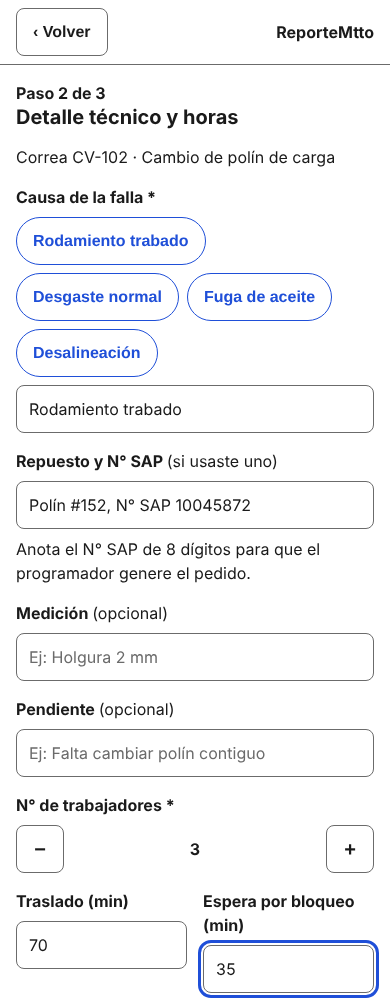

# Análisis ético del prototipo · ReporteMtto

Este análisis se hace sobre el prototipo de [`docs/prototipo.md`](prototipo.md) (código en `src/`) y sobre lo que nos contó el supervisor en la conversación del Avance 4 ([`docs/conversacion-supervisor.md`](conversacion-supervisor.md)).

## B1 · Mapa de impacto y exclusión

| Actor | Qué tarea deja de realizar | Cómo se redefine su rol | Riesgo si nadie asume esa responsabilidad |
|---|---|---|---|
| **Quien ejecuta la tarea:** supervisor de turno de mantenimiento mecánico | Dejar para el final del turno la transcripción del checklist (hoy le toma unas 2 horas antes de que termine el turno) y entregar el papel, a veces al día siguiente | Pasa a registrar el dato en el momento, con el N° SAP del repuesto y la causa, y a firmar en la pantalla. Es quien responde por la calidad del dato | Si nadie revisa lo que se registra, el checklist rápido queda con datos incompletos (un repuesto sin N° SAP) y el programador no puede generar el pedido |
| **Quien decide o supervisa:** programador de mantenimiento (y el mandante, que firma el documento impreso) | Recibir papeles o mensajes sueltos y transcribirlos | Pasa a revisar la bandeja, corregir el N° de OT y descargar el documento para llevarlo al mandante | Si nadie mira la bandeja, los checklist quedan sin N° de OT y se retrasan las horas hombre y el cierre en SAP, que es el problema que queremos resolver |
| **Quien queda excluido (1):** supervisor o personal de turno sin teléfono propio adecuado, o que trabaja en un sector sin señal ni datos móviles, o que no tiene el hábito de usar apps | Nada: **sigue igual**, entregando en papel o avisando por radio al ingeniero de turno o al planificador, como nos contó el supervisor | El ingeniero de turno o el planificador pasan a ser intermediarios que anotan lo que se dice por radio | Sus trabajos no aparecen en la bandeja ni en las horas hombre registradas, y las decisiones se toman con datos de quienes sí pueden usar la app. Nadie asume cargar esos datos después |
| **Quien queda excluido (2):** técnicos y ayudantes de la cuadrilla | Nada | No tienen rol en la app: solo cuentan como un número (`n_trabajadores`). No firman ni son nombrados | Si el supervisor anota mal la cantidad de trabajadores, las horas hombre salen mal y nadie de la cuadrilla puede verlo ni reclamar |

La exclusión (1) es la más importante, porque la app asume teléfono y señal. Por eso el prototipo conserva el camino «Sin señal» (el checklist se guarda y se envía al volver la señal) y esta decisión: en esta etapa **no se reemplaza** el aviso por radio. Un checklist pendiente no es visible para el programador hasta que se sincroniza.

## B2 · Ficha de tratamiento de datos personales

Una fila por cada campo del formulario del prototipo. Todos existen en `docs/datos/estructura_datos.md`. «Acceso»: **autor** es el supervisor que creó el checklist; **programador** ve la bandeja; **equipo** es quien administra el sistema. Los plazos son **propuestas del equipo** que falta validar con el mandante.

| Campo (pantalla) | ¿Dato personal? | Finalidad (historia) | Quién accede | Cuánto se conserva |
|---|---|---|---|---|
| `area` (P1) | No | Saber dónde se hizo el trabajo (HU-01) | Autor, programador, equipo | 2 años desde la fecha del turno |
| `equipo` (P1) | No | Identificar el equipo intervenido (HU-01) | Autor, programador, equipo | 2 años desde la fecha del turno |
| `actividad` (P1) | No | Describir el trabajo realizado (HU-01) | Autor, programador, equipo | 2 años desde la fecha del turno |
| `fecha_turno` (P1, automático) | Indirecto: junto al autor dice cuándo trabajó | Ubicar el checklist en el turno correcto (HU-01, HU-04) | Autor, programador, equipo | 2 años desde la fecha del turno |
| `turno` (P1, automático) | Indirecto, igual que la fecha | Filtrar la bandeja por turno (HU-04) | Autor, programador, equipo | 2 años desde la fecha del turno |
| `hora_inicio` (P1) | Indirecto | Calcular las horas hombre (HU-01) | Autor, programador, equipo | 2 años desde la fecha del turno |
| `hora_termino` (P1) | Indirecto | Calcular las horas hombre (HU-01) | Autor, programador, equipo | 2 años desde la fecha del turno |
| `n_ot` (P1 y P5) | No | Asociar el checklist a la orden de trabajo; el programador lo completa o corrige (HU-01, HU-04) | Autor, programador, equipo | 2 años desde la fecha del turno |
| `descripcion` · causa de falla (P2) | No, mientras no se escriban nombres | Dejar el detalle técnico (HU-01) | Autor, programador, equipo | 2 años desde la fecha del turno |
| `descripcion` · repuesto y N° SAP (P2) | No | Que el programador genere el pedido sin depender de la memoria del supervisor (HU-02) | Autor, programador, equipo | 2 años desde la fecha del turno |
| `descripcion` · medición (P2) | No | Dejar el detalle técnico (HU-01) | Autor, programador, equipo | 2 años desde la fecha del turno |
| `descripcion` · pendiente (P2) | No, mientras no se escriban nombres | Avisar qué queda por hacer (HU-01) | Autor, programador, equipo | 2 años desde la fecha del turno |
| `n_trabajadores` (P2) | No: es una cantidad, no personas | Calcular las horas hombre (HU-01) | Autor, programador, equipo | 2 años desde la fecha del turno |
| `min_traslado` (P2) | No | Calcular las horas hombre (HU-01) | Autor, programador, equipo | 2 años desde la fecha del turno |
| `min_espera_bloqueo` (P2) | No | Calcular las horas hombre (HU-01) | Autor, programador, equipo | 2 años desde la fecha del turno |
| `firma_url` (P3) | **Sí**: firma manuscrita | Dejar la entrega firmada por el supervisor (HU-03) | Autor, programador (en el documento descargado), equipo | Lo mismo que el checklist; el archivo de la firma se borra al borrar el checklist |
| Nombre del supervisor (P3, viene de `id_usuario`) | **Sí** | Mostrar quién firma (HU-03) | Autor, programador, equipo | Mientras la persona sea usuaria; se borra al darla de baja |

Además, `horas_hombre` y `estado` se calculan en el sistema y no se escriben. La copia que queda en el teléfono mientras no hay señal se borra al confirmarse el envío.

**Campo eliminado por no tener finalidad:** `foto_url` (tabla FOTO). El wireframe de P2 traía un botón «Foto» en cada campo, pero ninguna historia de usuario pide fotografías. Se quitó del formulario (ver la integración, más abajo).

## B3 · Sesgo, accesibilidad y transparencia

Revisión sobre las pantallas del prototipo, con mediciones hechas por nosotros en navegador móvil (390 px de ancho).

| Aspecto | P1 | P2 | P3 | P4 | P5 | Observaciones |
|---|---|---|---|---|---|---|
| Contraste texto/fondo (mínimo 4,5:1) | Cumple | Cumple | Cumple | Cumple | Cumple | El peor caso medido es 5,3:1 (texto de ayuda dentro de los campos). Botón azul con texto blanco: 6,6:1. Texto rojo de alerta: 6,5:1 |
| Elementos interactivos de al menos 24 × 24 px | Cumple | Cumple | Cumple | Cumple | Cumple | El más pequeño mide 48 × 48 px |
| Estado con texto y no solo con color | Cumple | Cumple | Cumple | Cumple | Cumple | «Enviado ✓» y «Pendiente de envío»; los errores empiezan con ⚠ y dicen qué corregir |
| Etiquetas visibles | Cumple | Cumple | Cumple | No aplica | Cumple | P4 no tiene campos. En la primera versión, «Nombre del equipo» y «Nombre de la actividad» (opción «Otro») solo tenían texto dentro del campo; se corrigió con etiqueta visible |

Limitaciones que **no** están resueltas:
- **La firma exige dibujar con el dedo.** Quien tenga dificultad de motricidad fina no puede completarla y no hay alternativa en el prototipo. Queda como riesgo (R3 en B4) y como mejora.
- No se probó con lector de pantalla ni con teclado; solo se revisó que cada campo tenga su etiqueta asociada.
- Las pantallas están en español; no hay otro idioma. Es adecuado para el equipo de turno que describió el supervisor, pero deja fuera a quien no lea español.

**Orden y prioridad.** La bandeja de P5 ordena por **llegada** (el más reciente arriba) y no prioriza otra cosa. Relega a los checklist antiguos que siguen sin N° de OT: aunque llegaron antes, quedan abajo y pueden quedar olvidados. Como mitigación, el programador puede filtrar por turno y equipo. Mejora a futuro: destacar los que no tienen N° de OT. Además, un checklist «pendiente» por falta de señal no aparece hasta sincronizar, de modo que los supervisores con peor señal aparecen más tarde en los datos.

**Inteligencia artificial.** No aplica: la app no usa IA en ninguna sugerencia (las sugerencias de causa de falla son una lista fija). La IA se usó solo para construir el proyecto y está registrada en `docs/bitacora-ia/bitacora.md`.

## B4 · Sostenibilidad y riesgos

**Prácticas de uso eficiente de recursos que adoptaremos**
1. La bandeja pide solo los campos que muestra (equipo, fecha, turno, estado, N° de OT, horas hombre); el detalle técnico y la firma se piden recién al descargar.
2. La firma se guarda como una imagen liviana de tamaño fijo, no como fotografía, y no se almacenan fotos en esta etapa.
3. Sin librerías externas en el prototipo (el sitio completo pesa unos 40 KB) y despliegues de prueba de Vercel desactivados para ramas que no sean `dev` y `main`.

**Riesgos**

| N° | Riesgo | Tratamiento | Responsable | Cuándo se revisa |
|---|---|---|---|---|
| R1 | Se pierde un checklist porque el teléfono no sincroniza (señal mala o datos locales borrados) | **Mitigar:** guardado local, aviso «Pendiente de envío» y reintento automático; probar en un teléfono real sin señal | Felipe Narbona | En la sesión de equipo antes de conectar la base de datos |
| R2 | Se filtran datos personales (firma y nombre) por permisos mal configurados | **Mitigar:** acceso por rol, plazo de conservación de 2 años y repositorio sin claves reales (`.env.example` sin valores) | Bastian Garay | Antes de publicar la primera versión con datos reales |
| R3 | Un supervisor sin teléfono adecuado, sin señal o que no puede firmar con el dedo queda fuera de la app | **Aceptar con justificación en esta etapa:** se mantiene el aviso por radio y el papel; la app no es obligatoria. Evaluar una alternativa de firma | Aldo Castillo | Después de probar el prototipo con al menos un supervisor |
| R4 | Un N° SAP mal escrito o ausente genera un pedido equivocado | **Mitigar:** aviso en pantalla si faltan los 8 dígitos y revisión del programador antes de generar el pedido | Sebastián Narbona | Cuando se defina la validación en el servidor |
| R5 | El prototipo público de Vercel recibe datos reales (firma o nombres) | **Evitar:** el prototipo solo usa datos de ejemplo y no tiene servidor | Todo el equipo; revisa Aldo Castillo antes de compartir el enlace | Cada vez que se publique una versión nueva |

## Integración con el prototipo

**Hallazgo del análisis:** al hacer la ficha de datos (B2) vimos que el botón «Foto» de P2 recogía `foto_url` sin que ninguna historia lo pidiera, y que una foto de la cuadrilla en terreno puede mostrar personas sin que ellas lo sepan. Por privacidad desde el diseño, el campo se elimina; el botón «Voz» tampoco tiene historia y se quita junto con él.

**Modificación en el prototipo:** se quitaron los botones «Foto» y «Voz» de los cuatro campos de detalle técnico de P2.

| Antes | Después |
|---|---|
|  |  |

Una segunda modificación salió de la revisión de accesibilidad (B3): los campos «Nombre del equipo» y «Nombre de la actividad» ahora tienen una etiqueta visible encima, en lugar de solo un texto dentro del campo.
