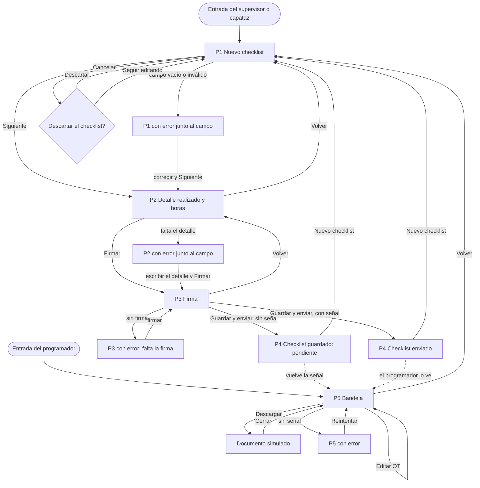

# Prototipo navegable · ReporteMtto

Enlace: PENDIENTE: pegar aquí el enlace de Vercel (debe abrirse sin iniciar sesión; probar en ventana de incógnito)

El prototipo está en [`src/`](../src/) (HTML, CSS y JavaScript, sin librerías externas). Las cinco pantallas son las del wireframe del Avance 4 (`docs/wireframes/`) y sus recuadros siguen el «Check list entrega trabajos de mantenimiento» que ya autorizó el mandante: no modificamos el checklist físico, lo pasamos al teléfono. Un reporte registra una actividad.

**Cómo recorrerlo.** La franja negra de arriba son controles del prototipo, no de la app: simulan lo que en la app real vendría del inicio de sesión y de la red.
- **Vista:** Supervisor o Capataz (empiezan en P1; solo cambia el cargo que aparece en la firma) o Programador (empieza en P5).
- **Señal:** «Sin señal» activa el camino alternativo de la historia principal; al volver a «Con señal» los checklist pendientes se envían.
- **Bandeja:** «Vacía» muestra el estado vacío de P5.

Los datos del usuario (por ejemplo «Juan Pérez», «Sigma S.A.») son de ejemplo. En la app real el nombre, el cargo y la empresa vienen del perfil de quien inicia sesión, no se escriben en cada checklist.

## Sistema mínimo (A2)

Texto: 20 px (títulos y cifra destacada) y 16 px (todo lo demás) · Acción: azul `#1F4FD8` · Alerta: rojo `#B3261E` · Espaciado: 8 px (todo es múltiplo de 8)

Los grises de texto, borde y fondo son neutros y no cuentan como color. Cada pantalla tiene un solo botón dominante (azul y relleno); las acciones secundarias tienen borde y fondo blanco.

## Mapa de navegación (A3)

Cada pantalla responde ¿dónde estoy? (título y «Paso x de 3»), ¿cómo continúo? (un solo botón principal) y ¿cómo vuelvo? (botón «Volver», «Inicio» o «Cancelar» arriba a la izquierda). En P1, que es la entrada, ese botón es «Cancelar». En P4 es «Inicio», para no volver a la firma y enviar dos veces. En P5 lleva a P1 porque en el prototipo ambas son puntos de entrada; en la app real sería cerrar sesión.

Caminos alternativos (ambos se pueden recorrer en el prototipo):
1. **Sin cobertura** (criterio alternativo de HU-01): elegir «Sin señal» en los controles, completar el checklist y tocar «Guardar y enviar». Se ve el estado «Pendiente de envío» con el aviso «Se enviará al recuperar señal» y se puede abrir un checklist nuevo.
2. **Campo vacío o inválido:** tocar «Siguiente» en P1 sin completar, o «Firmar» en P2 sin el detalle realizado, o «Guardar y enviar» en P3 sin firma. El error aparece junto al campo y dice cómo corregirlo.

Además se puede **cancelar** en P1 (con confirmación) y la bandeja muestra un **error de conexión** si se elige «Sin señal».

## Pantallas y campos

| Pantalla | Campos (como en la hoja oficial) |
|---|---|
| P1 · Nuevo checklist | Área (Superficie, Chancado, Transporte intermedio, Transporte principal u Otro), Equipo (lista según el área u Otro), fecha y turno (automáticos), Equipo de la actividad (texto), Hora inicio, Hora término, N° OT SAP (opcional, 9 dígitos) |
| P2 · Detalle realizado y horas | Detalle realizado (texto, se puede pegar desde las notas del teléfono), Observaciones detectadas durante recepción de actividades (opcional; ahí va el N° SAP de un repuesto si hace falta), Duración (calculada), Tiempo traslado, Tiempo espera bloqueo, N° trabajadores, Horas hombre (calculadas) |
| P3 · Firma | Nombre, cargo (Supervisor o Capataz) y empresa de quien entrega (del perfil) y firma con el dedo. La firma de quien recibe la hace el mandante en el documento impreso |
| P4 · Confirmación | Estado (enviado o pendiente) y horas hombre |
| P5 · Bandeja | Filtros por turno y equipo, edición del N° de OT y descarga del documento, que replica la hoja oficial |

## Formulario y estados (A4)

Las cuatro decisiones de diseño del formulario:
- **Solo campos justificados.** Cada campo existe en la hoja oficial, viene de una historia y está en `docs/datos/estructura_datos.md`. No hay campos de foto, voz, causa de falla ni repuesto (ver `docs/etica.md`, integración).
- **Etiqueta siempre visible** sobre cada campo; el texto de ayuda dentro del campo solo da un ejemplo.
- **Error junto al campo**, con ⚠ y un mensaje que dice cómo corregir (por ejemplo: «El N° de OT tiene 9 dígitos, por ejemplo 111254880. Corrígelo o déjalo vacío.»).
- **Opciones en vez de texto libre:** área y equipo son listas (con «Otro» para escribir a mano); las horas se marcan con «Ahora»; fecha y turno son automáticos; los trabajadores se ajustan con + y −; la duración y las horas hombre se calculan solas.

| Estado | Dónde se ve |
|---|---|
| Con datos | P5 con dos checklist de ejemplo (más los que se envíen durante la prueba) |
| Vacío | P5 con «Bandeja: Vacía» (o filtros sin resultados) |
| De carga | «Enviando…» en el botón de P3 y «Cargando bandeja…» al entrar a P5 |
| De error | Errores de campo en P1, P2, P3 y al editar la OT en P5; «No se pudo actualizar la bandeja» sin señal |

En la bandeja y en P4 el estado se expresa con texto y color («Enviado ✓» y «Pendiente de envío» en rojo). Las horas hombre son un dato único, así que se muestran como cifra destacada y no como gráfico.

## Registro de decisiones (A5)

| Pantalla | Historia | Criterio que verifica | Simulado | Funcional |
|---|---|---|---|---|
| P1 · Nuevo checklist | HU-01 | Escenario principal: están los campos obligatorios; si falta alguno se marca antes de seguir | Listas de áreas y equipos (catálogo de ejemplo, falta confirmar la lista de Chancado frente a Transporte intermedio y la de Superficie); fecha y turno toman la hora del teléfono | Validación de campos obligatorios y del N° de OT de 9 dígitos; botón «Ahora»; «Cancelar» con confirmación; navegación |
| P2 · Detalle realizado y horas | HU-01 y HU-02 | HU-01: la persona ve sus horas hombre calculadas antes de enviar. HU-02: las observaciones aceptan el N° SAP del repuesto | El texto pegado desde las notas (se escribe en el campo) | Cálculo de horas hombre en vivo (fórmula de `estructura_datos.md`; con los datos reales da 12,5 y 6,0); validación de minutos y del detalle |
| P3 · Firma | HU-03 | El supervisor ve su firma dibujada en la pantalla antes de enviar; el mandante firma después, en papel | El nombre, cargo y empresa (datos de ejemplo del perfil) y el envío (espera de 1,2 segundos, sin servidor) | Firma con el dedo o el mouse, «Limpiar», error si falta la firma, estado «Enviando…» |
| P4 · Confirmación | HU-01 | Principal: «Checklist enviado», estado «enviado» y horas hombre. Alternativo: estado «pendiente» con «Se enviará al recuperar señal» | Que el envío llegue al servidor | Los dos resultados según el control «Señal»; reenvío automático al volver la señal; «Nuevo checklist» |
| P5 · Bandeja del programador | HU-04 | El checklist llega con su detalle y firmado por el supervisor; el N° de OT se puede completar o corregir; el documento se puede descargar | Los dos checklist de ejemplo; el documento «Descargar» (vista previa de cómo sería el PDF, con los recuadros de la hoja oficial y espacio para la firma del mandante) | Filtros por turno y equipo, edición del N° de OT con validación, estados vacío, de carga y de error |

## Publicación

El enlace de arriba es la vista de Vercel del repositorio con la carpeta raíz `src`. Para que se abra sin iniciar sesión, en Vercel se usa el enlace de producción (rama `main`) o se desactiva la protección de la vista previa.
